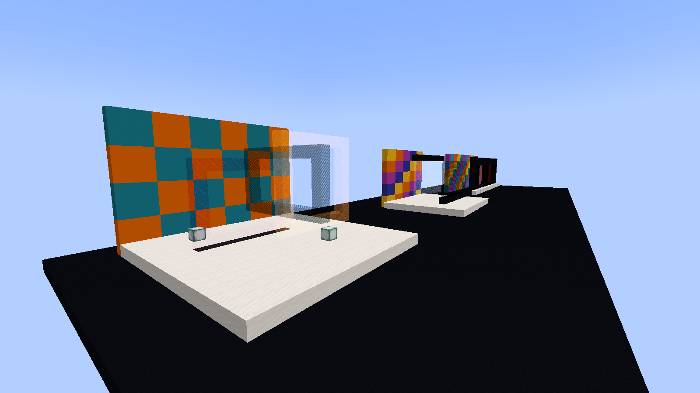
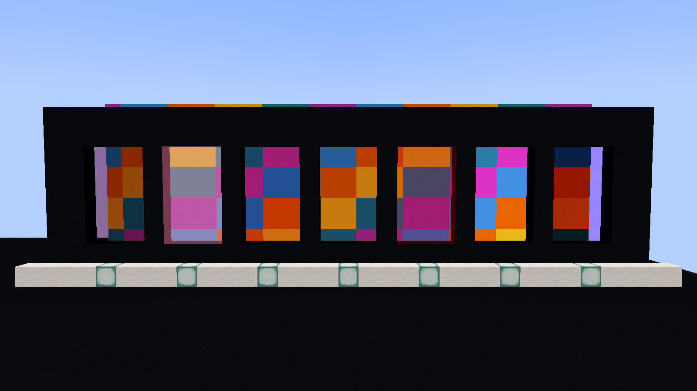
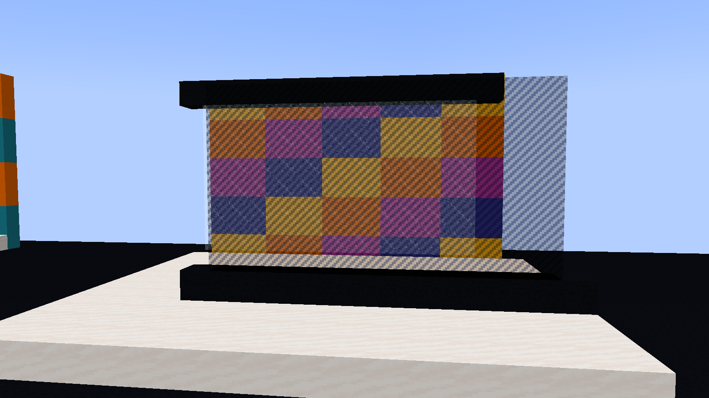
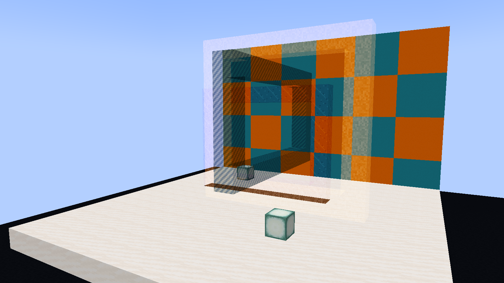

# Original Minecraft art experiments

These studies use BlockBlend's real scene-color renderer on vanilla opaque full blocks. The images are native Minecraft framebuffer screenshots, without image compositing, recoloring, AI generation, or HUD overlays. The source fixture writes ordinary persisted `BlendTag` values to a new disposable integrated-server world and synchronizes them through the production chunk-data channel.

Directly adjacent eligible painted cubes with nonzero opacity form one exterior region: their shared internal faces are omitted, even when their materials or paint settings differ. An opacity-zero cell is a visual gap and exposes the neighboring visible surface. Separate painted layers need air between them to retain independent depth compositing; the gallery's screens are four blocks apart. Original physical collision and lighting remain.



## Seven mode windows



Seven apertures form a continuous color instrument. Each window has the same pink-concrete surface and **70% opacity**, so the differences come from the blend equation and the actual background colors. From left to right: **Multiply, Screen, Overlay, Soft Light, Hard Light, Color Dodge, Color Burn**. Pattern strength is **0%**. The uninterrupted concrete quilt sits six blocks behind the windows; its colors continue through the altered surface.

The source uses window coordinates `x=11-4m..13-4m`, `y=81..85`, `z=20`, where `m=0..6` selects the mode. The camera looks along +Z, so image-left is world +X; this placement makes the photographed order match the list above. A black-concrete surround frames each three-by-five window. The quilt occupies `x=-15..15`, `y=79..88`, `z=26`, with three-column/two-row patches cycling cyan, yellow, orange, light blue, and magenta concrete.

## Layered screens



Two offset sheets make pattern strength and opacity visible as separate decisions. The front sheet uses pink concrete, **Multiply**, **Stripes 90%**, **opacity 60%**. Behind it, a light-blue-concrete sheet uses **Screen**, **Scratches 80%**, **opacity 60%**. Their overlapping areas combine in depth order over the yellow/blue/magenta/orange wall, while the exposed edges show each sheet's contribution.

Front coordinates are `x=31..41`, `y=81..86`, `z=18`; rear coordinates are `x=33..43`, `y=81..86`, `z=22`. The quilt sits at `z=27`, `x=31..45`, `y=79..88`. Quartz plinths and black rails are ordinary opaque geometry. All screen cells retain their original full-block collision and lighting behavior.

## Chromatic ring sculpture



Three rectangular rings cross in different planes and depths. The orange front ring uses **Screen**, **Noise 30%**, **opacity 70%**; the light-blue perpendicular ring uses **Multiply**, **Stripes 70%**, **opacity 60%**; the magenta rear ring uses **Soft Light**, **Scratches 60%**, **opacity 70%**. Open space, visible background, and surface overlap share the composition.

The orange XY ring occupies the perimeter of `x=66..73`, `y=81..88`, `z=20`. The blue YZ ring occupies the perimeter of `x=71`, `y=82..87`, `z=18..27`. The magenta XY ring occupies the perimeter of `x=69..77`, `y=80..86`, `z=25`. At shared block coordinates, the later ring replaces the earlier cell, matching Minecraft's one-block-per-position rule. A cyan/orange concrete quilt at `z=32` supplies scene color.

## Reproduce the gallery

Use **JDK 21**, then run from the source-project root:

```powershell
.\gradlew.bat runShowcaseClient
```

```sh
./gradlew runShowcaseClient
```

This development-only source set is excluded from the distributable mod. It starts a fresh flat world with seed **178123**, builds the gallery, checks every persisted surface against the client cache and production renderer, captures four frames through Minecraft's `ScreenshotRecorder`, records a bounded render-interval sample, and exits. There is no command to modify a player world. The harness requires a run directory ending in `build/showcase/client`; ordinary launcher directories are rejected.

Default run directory: `build/showcase/client`. Default evidence parent: `build/showcase/evidence`; each invocation creates a unique `blockblend-art-<UUID>` child so previous captures and receipts are retained. Worlds, logs and raw receipts remain generated local files under ignored `build/`.

Optional launch properties:

```powershell
.\gradlew.bat runShowcaseClient "-PshowcaseWidth=1600" "-PshowcaseHeight=900" "-PshowcaseOutputDir=build/showcase/evidence"
```

Rendering settings are Fancy graphics, vanilla Fabric/Indigo, ambient occlusion off, gamma 1, view distance 8, simulation distance 5, clouds off, view bobbing off, hidden HUD, spectator camera, noon, clear weather, and frozen daylight/weather. These affect only the disposable development client's settings. All backgrounds are ordinary opaque blocks; the fixture does not qualify glass/water/particle interleaving or third-party renderers.

| Frame | Player position (camera adds Minecraft's eye height) | Yaw / pitch | FOV |
| --- | --- | --- | --- |
| Overview | `87, 85, 4` | `53 / 7` | 65 |
| Seven modes | `0.5, 83.1, -3.5` | `0 / 3` | 42 |
| Layered screens | `35.5, 82.5, 4` | `-7 / 3` | 43 |
| Sculpture | `64, 84, 7` | `-29 / 6` | 44 |

Layouts and settings are defined in [ArtShowcase.java](src/showcase/java/com/example/blockblend/showcase/ArtShowcase.java). The generated receipt records the exact framebuffer dimensions, camera settings, persisted surface count and render interval sample. Frame timing includes scheduling and display synchronization and describes only this small gallery; it is not a dense-world benchmark. BlockBlend does not promise general translucent-world sorting or physically transparent lighting.
